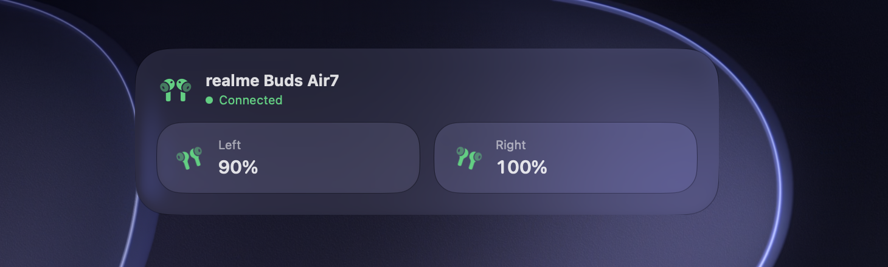
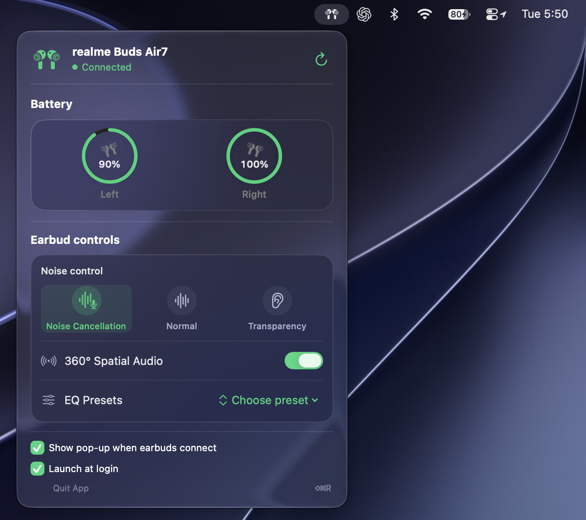
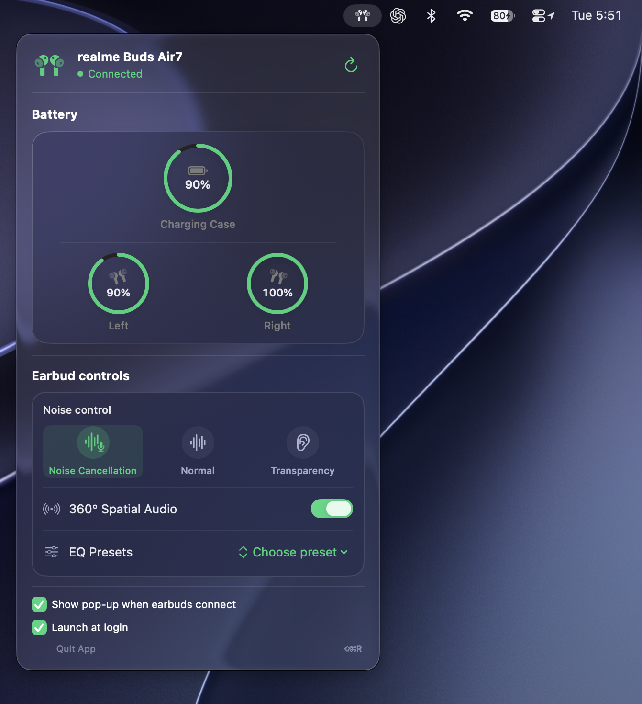

# Air 7 Menu

Air 7 Menu is a native macOS menu bar companion for the realme Buds Air 7. It puts earbud connection and battery information in the menu bar and, when the earbuds support the expected control service, lets you adjust listening features without opening the phone app.

The project is written in SwiftUI and uses macOS Bluetooth and audio frameworks. It also includes a small background monitor that watches for earbud connection events and can bring up a battery pop-up.

## Screenshots

The app shows a compact battery pop-up when the earbuds connect, and a fuller control panel from the menu bar icon. The charging case appears when the earbuds report its battery level.

| Connection pop-up | Menu bar controls |
| --- | --- |
|  |  |



## What it does

- Shows whether the realme Buds Air 7 are connected and displays left and right earbud battery levels. Case battery is shown when the earbuds provide it.
- Provides noise control modes (noise cancellation, normal, and transparency), ANC strength where available, 360° spatial audio, and EQ presets.
- Can show a battery pop-up on connection and low-battery notifications.
- Can launch at login.
- Includes `Air7Monitor`, a helper that watches Bluetooth connection events so the app can react when the earbuds connect.

Some readings and controls depend on the earbuds exposing the relevant Bluetooth service and responding to the command. Firmware and macOS behavior can vary, so unavailable controls do not necessarily indicate an app problem.

## Requirements

- macOS 13 or newer.
- Xcode with the macOS SDK and Swift 6 toolchain.
- A paired realme Buds Air 7 for Bluetooth features. The app can launch without connected earbuds.

## Build and run

Open `Air7Menu.xcodeproj`, select the `Air7Menu` scheme and **My Mac**, then build and run. The project includes the menu bar app and its `Air7Monitor` helper.

To build a local app bundle with the provided script:

```sh
./build-app.sh
```

The script builds the Debug configuration, copies the bundle to `Air 7 Menu.app`, ad-hoc signs it for local use, and opens it. It requires Xcode at `/Applications/Xcode.app` or a suitable active developer directory. This local ad-hoc signature is not Developer ID signing or notarization.

To run the Swift package tests:

```sh
swift test
```

## Bluetooth and protocol notes

The app uses CoreAudio to observe the default output and IOBluetooth to find a paired, connected device, discover its companion control service, and communicate over RFCOMM. The monitor helper observes Bluetooth connect and disconnect events.

The Air 7 vendor protocol is not documented in the product specification. Public reverse-engineering material describes BBK `oppointeraction`/OPOv1 behavior on other earbuds, and one controller documents mappings for the realme Buds T500 Pro; that does not independently verify every Air 7 command or response. Treat device control and battery behavior as firmware-dependent. The [release report](release/BUILD-REPORT.md) describes checks performed for this build and scenarios that remain unverified; a successful build or visible UI is not proof of hardware behavior.

## Research sources

- [realme Buds Air 7 product manual/specification](https://manuals.plus/m/70aa0bdacdae1e027c2bf2549970d08cce20e117363fea8346022cfd3ba0fa8d)
- [Realme TWS Mac Controller protocol notes](https://github.com/anikket-b/Realme-TWS-Mac-Controller) — mappings documented for Buds T500 Pro, not a complete Air 7 verification
- [BudsLink Air 7 testing request](https://github.com/maniacx/BudsLink/issues/60) — community request for Air 7 owners to capture device details and test a configuration
